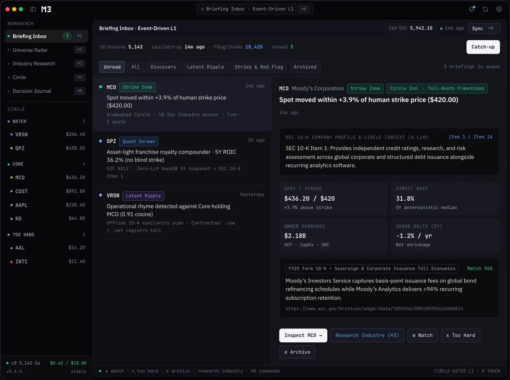

<p align="right">
  <strong>English</strong> · <a href="./README.zh-CN.md">简体中文</a> · <a href="https://m3.thinksmart.systems">Website</a>
</p>

# M3

**The research instrument for patient investors.**  
*Read every filing. Swing only at the fat pitches.*

[](https://github.com/thinksmart-systems/m3/actions/workflows/ci.yml)
[](https://github.com/thinksmart-systems/m3/releases/latest)
[](./LICENSE)
[](https://github.com/thinksmart-systems/m3/releases)
[](https://m3.thinksmart.systems)

M3 indexes every US SEC filer on your own Mac (`6,000+` issuers in embedded DuckDB + ZSTD Parquet), computes owner earnings, ROIC, and share dilution in deterministic Rust (`rust_decimal`) with SHA-256 filing provenance, runs four-lens adversarial research and Socratic Feynman coaching powered by built-in **[Alan](https://alanworks.app)**, and leaves every judgment to you.

<p align="center">
  <a href="https://m3.thinksmart.systems">
    
  </a>
</p>

> **Scope (`v0.6.x` · Paper Research)**: Today M3 is strictly a local research, accounting verification, and decision-journaling instrument (`PAPER RESEARCH`) — it stores no brokerage credentials and places no live orders. See [ROADMAP.md](./ROADMAP.md) for upcoming strategy backtesting (`v0.7`) and opt-in risk-gated execution (`v0.8+`).

---

## Four Iron Rules

Inspired by Charlie Munger's habit of inverting every thesis before trusting an answer:

1. **Arithmetic is sacred** — Language models never touch an accounting number. Multi-year ROIC, Strict Owner Earnings (`OCF − CapEx − SBC`), 3-year share count change, reverse-implied growth, Strike Price, and accounting red flags are computed in fixed-point `rust_decimal` directly from primary SEC EDGAR XBRL facts.
2. **Invert, always invert** — Deep research interrogates where a thesis breaks before asking what it pays (*Moat*, *Accounting Reality*, *Latent Peers*, *5-Year Pre-Mortem*). `TOO HARD` is a first-class outcome.
3. **Judgment belongs to the owner** — M3 never outputs buy or sell advice. Human fields (`my_stance`, `weight_rationale`, `falsification_metrics`, `feynman_checked_at`, and `## Human Notes`) cannot be overwritten by AI, and moving a company from `WATCH` to `IN` triggers a calm 3-round Socratic Feynman check.
4. **Sit calmly** — Runs locally on macOS with zero cloud backend. The filing inbox costs zero LLM tokens, proactive Circle triage and deep research sit behind hard daily/monthly caps, and quiet weeks say so plainly: *"No fat pitches · Stay patient."*

---

## Quick Install (macOS Apple Silicon)

Installs `/Applications/M3.app`, links `~/.local/bin/m3`, and verifies SHA-256 checksums before swapping:

```bash
# Latest stable release
curl -fsSL https://m3.thinksmart.systems/install.sh | bash

# Rolling beta channel (built from main)
curl -fsSL https://m3.thinksmart.systems/install.sh | bash -s -- --channel beta
```

Signed release archives and SHA-256 manifests are also available directly on [GitHub Releases](https://github.com/thinksmart-systems/m3/releases). You can also explore the live interactive Workbench in your browser at **[m3.thinksmart.systems](https://m3.thinksmart.systems)**.

---

## What's Inside

- **Deterministic Financial Kernel (`crates/m3-core`)** — Exact `rust_decimal` Charlie Calculator, SHA-256 SEC EDGAR XBRL provenance, automated red-flag rules, and point-in-time metric snapshots.
- **Three-Layer Local Lakehouse**
  - **L0 Market Lakehouse**: Bulk SEC EDGAR `submissions.zip` & `companyfacts.zip` materialized into immutable ZSTD Parquet generations and embedded `m3.duckdb` with sub-second screening and SIC peer percentiles.
  - **L1 Event Inbox & Hybrid Retrieval**: Zero-token `8-K` / `10-K` / `10-Q` / RSS watcher with local 256-dimensional cosine + BM25 hybrid search (`search_similar`) and verbatim filing evidence cards.
  - **L1.5 & L2 Unified Alan**: Circle-scoped Filing Watchdog (`WATCH + IN` only), calm 3-part daily/weekly briefings, 4-perspective adversarial research, 3-round Socratic Feynman coach, and a Dual-Canvas workspace (`Closed | Split | Immersive`) with pinned context and inline deterministic evidence cards.
- **Native macOS Workbench (`apps/m3-nsh`)** — Built in Rust on Longbridge NSH `0.7.0`: smoked-glass shell, bilingual English/Chinese UI, `WATCH → IN → OUT → TOO HARD` Circle, Industry Research Studio, Canvas K-line & ROIC scatter charts, `⌘K` Command Palette, Menu Bar keep-alive tray, Storage Manager, and local `control.sock` IPC.
- **Agent-Native CLI (`m3`) & 40-Tool MCP Server (`m3 mcp`)** — Structured schema-v1 JSON across every workflow (auto-pretty on TTY, single-line when piped) plus a zero-dependency stdio MCP server (`40` tools default, or `24` strictly read-only tools with `--read-only`).

---

## CLI & MCP Quickstart

```bash
# Health check: binary, Alan connection, workspace, DuckDB lakehouse, and disk usage
m3 doctor

# Sync and screen the local US equity lakehouse
m3 universe sync --full --prices-top 400
m3 universe screen --min-roic 15 --max-sbc-ocf 25 --limit 25

# Inspect Circle status, unread filing signals, and calm briefings
m3 status
m3 inbox list --status unread --limit 20
m3 briefing latest

# Drive scoped Alan sessions or the live M3.app desktop canvas
m3 alan --help
m3 app --help

# Reclaim rebuildable SEC/DuckDB caches (personal workbench files are never deleted)
m3 storage status
m3 update --check
```

### Connect External Coding / Research Agents (`m3 mcp`)

```bash
# Claude Code — full 40-tool surface (24 read-only + 16 controlled workbench/Alan/UI tools)
claude mcp add m3 -- m3 mcp

# Strictly read-only mode (24 tools; write/action calls are rejected)
claude mcp add m3-readonly -- m3 mcp --read-only
```

For Codex (`~/.codex/config.toml`), Cursor, or Antigravity MCP configuration, see [`skills/m3/SKILL.md`](./skills/m3/SKILL.md) and [`docs/mcp-server.md`](./docs/mcp-server.md).

---

## Repository Structure

| Path | Role |
| :--- | :--- |
| [`crates/m3-core`](./crates/m3-core) | Zero-UI deterministic engine: SEC EDGAR sync, `rust_decimal` accounting, `L0`/`L1`/`L1.5`/`L2` lakehouse, proactive watchdog, Feynman coach, Industry Studio, storage manager, i18n, self-updater |
| [`crates/m3-cli`](./crates/m3-cli) | Schema-v1 JSON CLI (`m3`) and 40-tool stdio MCP server (`m3 mcp`) |
| [`apps/m3-nsh`](./apps/m3-nsh) | Native macOS desktop workbench (`M3.app`) on Longbridge NSH `0.7.0` with `control.sock` IPC |
| [`website`](./website) | Bilingual financial-newspaper site & browser Workbench showcase (`m3.thinksmart.systems`, Solid 2 + Vite 8 + Cloudflare Workers) |
| [`skills`](./skills) | First-party Agent Skills (`m3`, `m3-qa`) |
| [`docs`](./docs) | Architecture specs, MCP/CLI contracts, Munger human-agent workflow, and pre-registered research reviews |
| [`scripts`](./scripts) | macOS bundle assembly, `install.sh`, release automation, and SHA-256 manifest generator |

Disk ownership is strictly separated:
- `workbench/` — human-owned & curated state (`watchlist.json`, `dossiers/`, `industries/`, `memos/`, `themes.json`, `budget.json`, `journal.json`), never touched by cache cleanup.
- `data/munger/` — rebuildable SEC archives, `m3.duckdb`, and ZSTD Parquet generations.
- `~/Library/Application Support/M3/` — host preferences (`config.json`), updater receipts, and the default standalone workbench.

---

## Development

Requires macOS on Apple Silicon (`aarch64-apple-darwin`), Rust `1.98.1` (`rustfmt`, `clippy`), and Node.js + `pnpm` (for `website/` only):

```bash
# Formatting & strict lint gate (zero warnings; zero production .unwrap()/.expect())
cargo fmt --all -- --check
cargo clippy --workspace --locked --all-targets -- -D warnings

# Workspace test suite
cargo test --workspace --locked -j 4

# Build local macOS bundle -> apps/m3-nsh/artifacts/M3.app
./apps/m3-nsh/build.sh

# Build & prerender website (en + zh)
pnpm --dir website install && pnpm --dir website build
```

See [CONTRIBUTING.md](./CONTRIBUTING.md) for full CI checks and contribution standards.

---

## Roadmap

| Version | Milestone | Highlights | Status |
| :--- | :--- | :--- | :--- |
| `v0.4` | Native macOS Workbench | Longbridge NSH `0.7` desktop rewrite, `m3-core` / `m3-cli` split, K-line & ROIC scatter charts, Storage Manager | **Shipped** |
| `v0.5` | Onboarding & MCP | In-app 5-provider Alan setup, starter workspace, progressive L0 bootstrap, `m3 mcp` & Agent Skill | **Shipped** |
| `v0.6.0` | Proactive Alan | L1.5 Circle Filing Watchdog, calm daily/weekly briefings, Menu Bar keep-alive, 3-round Feynman coach | **Shipped** |
| `v0.6.5` | Unified Alan & 40-Tool MCP | Dual-canvas Alan shell, pinned context, inline evidence cards, `m3 alan` / `m3 app` CLI, `control.sock` IPC, 40-tool `m3 mcp` | **Shipped** |
| `v0.7` | Strategy Engine & Paper Broker | Declarative value strategies, point-in-time DuckDB/Parquet backtesting, built-in local Paper Broker | **Next** |
| `v0.7.5` | Multi-Market & HKEX | Hong Kong (`HKEX`) filing ingestion and multi-currency deterministic accounting | **Planned** |
| `v0.8 – v1.0` | Guarded Execution | Hardcoded Rust `RiskEngine`, opt-in Longbridge / Alpaca adapters, owner-mandated portfolio sleeves | **Planned** |

Full milestone details and safety invariants live in [ROADMAP.md](./ROADMAP.md).

---

## Documentation

- [Roadmap (`v0.5 → v1.0`)](./ROADMAP.md) · [Changelog](./CHANGELOG.md)
- [MCP Server Reference (`40` Tools)](./docs/mcp-server.md) · [Agent & CLI Contract](./docs/agent-interface.md)
- [System Architecture](./docs/architecture.md) · [Munger Human-Agent Workflow](./docs/munger-workflow.md)
- [Pre-Registered Strategy Reviews (Abandoned Short-Horizon Experiments)](./docs/research)
- [Desktop Bundle Guide](./apps/m3-nsh/README.md) · [Contributing](./CONTRIBUTING.md) · [Security Policy](./SECURITY.md)

---

## Disclaimer & License

M3 operates as a local research, accounting verification, and paper-journaling instrument (`PAPER RESEARCH`) with **no brokerage integration, no trading credentials, and no order execution**. Nothing produced by M3 constitutes investment, legal, or tax advice.

Licensed under the [Apache License, Version 2.0](./LICENSE).  
<sub><code>M³</code> — <em>Money · Making · Machine</em> · Powered by <a href="https://alanworks.app">Alan</a> · Built by <a href="https://github.com/thinksmart-systems">ThinkSmart Systems</a></sub>
