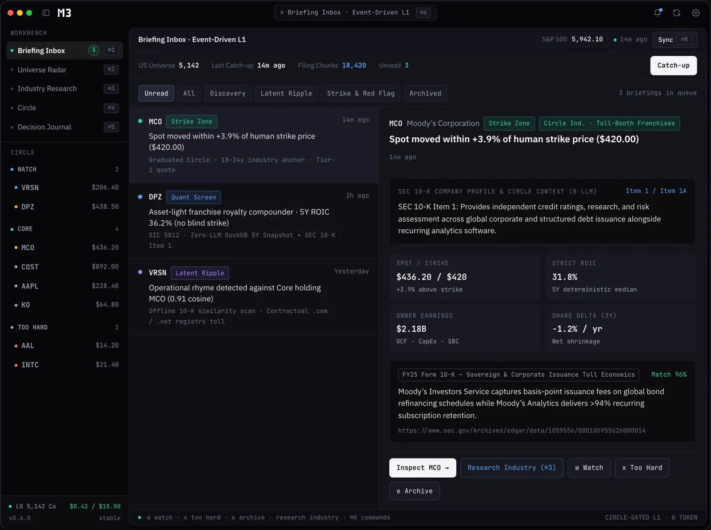

<p align="right">
  <a href="./README.md">English</a> · <strong>简体中文</strong> · <a href="https://m3.thinksmart.systems">官网</a>
</p>

# M3

**耐心投资者的研究仪器。**  
*读遍每一份财报，只挥击好球。*

[](https://github.com/thinksmart-systems/m3/actions/workflows/ci.yml)
[](https://github.com/thinksmart-systems/m3/releases/latest)
[](./LICENSE)
[](https://github.com/thinksmart-systems/m3/releases)
[](https://m3.thinksmart.systems)

M3 在你的 Mac 本地索引全部美股 SEC 申报公司（`6,000+` 家发行人，嵌入式 DuckDB + ZSTD Parquet），以确定性 Rust（`rust_decimal`）计算股东盈余、ROIC 与股本稀释并保留一手财报 SHA-256 溯源，借助内置 **[Alan](https://alanworks.app)** 开展四视角对抗审讯与苏格拉底费曼答辩，将最终判断完整留给你自己。

<p align="center">
  <a href="https://m3.thinksmart.systems">
    
  </a>
</p>

> **当前边界说明（`v0.6.x` · 模拟投研）**：目前 M3 严格定位为本地投研、财报核验与模拟决策账本工具（`PAPER RESEARCH`）——**不保存任何券商密钥，也不执行实盘交易**。关于后续防前视策略回测（`v0.7`）与受控风控执行（`v0.8+`）的规划，请查阅 [ROADMAP.md](./ROADMAP.md)。

---

## 四条铁律

灵感来自查理·芒格「先反过来想，再相信答案」的研究习惯：

1. **算术神圣** —— 语言模型绝不触碰任何财务数字。多年 ROIC、严格股东盈余（`OCF − CapEx − SBC`）、3 年股本变化率、反向隐含增速、击球价与财务排雷预警，均由定点 `rust_decimal` 直接从一手 SEC EDGAR XBRL 事实计算得出。
2. **反过来想，总是反过来想** —— 深度研究先问论点会在哪里崩溃，再谈潜在回报（护城河、会计真相、潜在同类公司、5 年事前验尸独立论证）。`TOO HARD`（太难）是一等公民结论。
3. **判断属于主人** —— M3 从不给出买卖建议。人类主权字段（`my_stance`、`weight_rationale`、`falsification_metrics`、`feynman_checked_at` 与 `## Human Notes`）不可被 AI 覆盖；将公司从 `WATCH` 移入 `IN` 时会触发平静的三轮费曼答辩门控。
4. **安坐** —— 纯本地运行于 macOS，无云端后台。财报收件箱零 Token 消耗，主动哨兵与深度研究均受日/月度硬预算约束；平静的周期会坦诚提示：「无球可挥 · 耐心等待」。

---

## 快速安装（macOS Apple Silicon）

自动安装 `/Applications/M3.app` 并建立 `~/.local/bin/m3` 命令软链，替换前严格校验 SHA-256：

```bash
# 安装最新稳定版（stable）
curl -fsSL https://m3.thinksmart.systems/install.sh | bash

# 或安装跟随 main 自动构建的测试通道（beta）
curl -fsSL https://m3.thinksmart.systems/install.sh | bash -s -- --channel beta
```

也可在 [GitHub Releases](https://github.com/thinksmart-systems/m3/releases) 直接下载签名安装包与校验清单，或在安装前先去 **[m3.thinksmart.systems](https://m3.thinksmart.systems)** 浏览交互式界面预览。

---

## 核心架构与能力

- **确定性财务内核（`crates/m3-core`）**：`rust_decimal` 查理计算器、SEC EDGAR XBRL SHA-256 溯源、自动化财务排雷规则与时点指标快照。
- **三层本地优先研究湖仓**
  - **L0 全美股湖仓**：批量解析 SEC EDGAR `submissions.zip` 与 `companyfacts.zip`，生成不可变 ZSTD Parquet 代际目录与嵌入式 `m3.duckdb`，支持亚秒级筛选与同 SIC 行业分位对照。
  - **L1 事件收件箱与混合检索**：零 Token 监控 `8-K`、`10-K`、`10-Q` 与新闻 RSS，内置本地 256 维余弦 + BM25 混合检索（`search_similar`）与逐字原文证据卡片。
  - **L1.5 & L2 统一 Alan 工作区**：仅针对 `WATCH + IN` 公司的财报哨兵、平静的日报/周报、四视角对抗深研、三轮苏格拉底费曼教练，以及带上下文锁定与内联确定性证据卡的双画布工作区（`Closed | Split | Immersive`）。
- **macOS 原生桌面工作台（`apps/m3-nsh`）**：基于 Rust 与 Longbridge NSH `0.7.0`，烟熏黑玻璃外观、中英双语即时切换、`WATCH → IN → OUT → TOO HARD` 能力圈、行业研究工作台、Canvas K 线与 ROIC 散点图、`⌘K` 命令面板、菜单栏常驻、存储管理器与本地 `control.sock` IPC。
- **Agent 原生 CLI（`m3`）与 40 工具 MCP 服务（`m3 mcp`）**：全流程 schema-v1 结构化 JSON（终端自动缩进，管道单行输出），内置零额外依赖的 stdio MCP 服务（默认开放全部 `40` 个工具，`--read-only` 严格收敛至 `24` 个只读工具）。

---

## CLI 与 MCP 快速上手

```bash
# 一键体检二进制、Alan 模型连接、工作区、DuckDB 湖仓与磁盘占用
m3 doctor

# 同步并筛选本地全美股湖仓
m3 universe sync --full --prices-top 400
m3 universe screen --min-roic 15 --max-sbc-ocf 25 --limit 25

# 查看能力圈状态、未读财报信号与平静简报
m3 status
m3 inbox list --status unread --limit 20
m3 briefing latest

# 在命令行驱动作用域绑定的 Alan 会话或控制运行中的 M3.app 桌面端
m3 alan --help
m3 app --help

# 查看并安全清理可重建缓存（绝不触碰个人观察池与研报）
m3 storage status
m3 update --check
```

### 接入外部编码 / 研究 Agent（`m3 mcp`）

```bash
# Claude Code — 完整 40 工具模式（24 只读 + 16 受控工作台/Alan/桌面控制工具）
claude mcp add m3 -- m3 mcp

# 严格只读模式（仅暴露 24 个只读工具，拒绝一切写入/动作调用）
claude mcp add m3-readonly -- m3 mcp --read-only
```

Codex（`~/.codex/config.toml`）、Cursor 与 Antigravity 的配置方式详见 [`skills/m3/SKILL.md`](./skills/m3/SKILL.md) 与 [`docs/mcp-server.md`](./docs/mcp-server.md)。

---

## 仓库目录结构

| 路径 | 说明 |
| :--- | :--- |
| [`crates/m3-core`](./crates/m3-core) | 零 UI 确定性核心：SEC EDGAR 同步、`rust_decimal` 会计核算、`L0`/`L1`/`L1.5`/`L2` 湖仓、财报哨兵、费曼教练、行业工作台、存储管理、i18n 与自更新引擎 |
| [`crates/m3-cli`](./crates/m3-cli) | 结构化 schema-v1 JSON CLI（`m3`）与 40 工具 stdio MCP 服务（`m3 mcp`） |
| [`apps/m3-nsh`](./apps/m3-nsh) | 基于 Longbridge NSH `0.7.0` 的原生 macOS 桌面应用（`M3.app`），含 `control.sock` IPC |
| [`website`](./website) | 双语金融报纸风格官网与交互式界面预览（`m3.thinksmart.systems`，Solid 2 + Vite 8 + Cloudflare Workers） |
| [`skills`](./skills) | 官方 Agent Skills（`m3`、`m3-qa`） |
| [`docs`](./docs) | 架构说明、MCP/CLI 契约、芒格人机工作流及预登记量化实验复盘 |
| [`scripts`](./scripts) | macOS 应用打包、一键安装脚本（`install.sh`）、发版与 SHA-256 清单生成工具 |

磁盘数据分层清晰：
- `workbench/` —— 人类主权与个人投研数据（`watchlist.json`、`dossiers/`、`industries/`、`memos/`、`themes.json`、`budget.json`、`journal.json`），缓存清理永不触碰。
- `data/munger/` —— 可随时重建的 SEC 原始归档、`m3.duckdb` 与 ZSTD Parquet 代际文件。
- `~/Library/Application Support/M3/` —— 本机配置（`config.json`）、更新凭据与独立运行时的默认工作区。

---

## 本地开发

需要 macOS Apple Silicon（`aarch64-apple-darwin`）、Rust `1.98.1`（含 `rustfmt`、`clippy`）以及 `Node.js` + `pnpm`（仅 `website/` 需要）：

```bash
# 格式与零警告静态检查（CI 强制要求生产代码零 .unwrap()/.expect()）
cargo fmt --all -- --check
cargo clippy --workspace --locked --all-targets -- -D warnings

# 运行全部工作区测试
cargo test --workspace --locked -j 4

# 构建本地 macOS 应用包 -> apps/m3-nsh/artifacts/M3.app
./apps/m3-nsh/build.sh

# 构建并预渲染双语官网（en + zh）
pnpm --dir website install && pnpm --dir website build
```

完整协作规范与发版前检查详见 [CONTRIBUTING.md](./CONTRIBUTING.md)。

---

## 演进路线图

| 版本 | 里程碑 | 核心内容 | 状态 |
| :--- | :--- | :--- | :--- |
| `v0.4` | 原生 macOS 工作台 | 基于 Longbridge NSH `0.7` 重写桌面端，拆分 `m3-core` / `m3-cli`，K 线与 ROIC 图表、存储管理 | **已交付** |
| `v0.5` | 零门槛上手与 MCP | 应用内 5 家模型配置、入门工作区、渐进式 L0 初始化、`m3 mcp` 与 Agent Skill | **已交付** |
| `v0.6.0` | 主动的 Alan | L1.5 能力圈财报哨兵、平静的日报/周报、菜单栏常驻、三轮苏格拉底费曼答辩教练 | **已交付** |
| `v0.6.5` | 统一 Alan 与 40 工具 MCP | 双画布 Alan 工作区、上下文锁定、内联证据卡、`m3 alan` / `m3 app` CLI、`control.sock` IPC、40 工具 `m3 mcp` | **已交付** |
| `v0.7` | 策略引擎与本地模拟盘 | 声明式价值策略、基于 DuckDB/Parquet 的防前视历史回测、内置本地 Paper Broker | **下一步** |
| `v0.7.5` | 港股与多市场扩展 | 港交所（`HKEX`）财报接入与多币种确定性会计核算 | **规划中** |
| `v0.8 – v1.0` | 受控风控执行 | 硬编码 Rust `RiskEngine` 风控闸门、可选接入长桥 / Alpaca 接口与授权资金池执行 | **规划中** |

完整架构演进与安全不变量请阅读 [ROADMAP.md](./ROADMAP.md)。

---

## 文档导航

- [演进路线图（`v0.5 → v1.0`）](./ROADMAP.md) · [更新日志](./CHANGELOG.md)
- [MCP 服务手册（`40` 工具）](./docs/mcp-server.md) · [Agent 与 CLI 数据契约](./docs/agent-interface.md)
- [系统架构说明](./docs/architecture.md) · [芒格人机审讯工作流](./docs/munger-workflow.md)
- [预登记短线策略复盘（已放弃实验档案）](./docs/research)
- [桌面打包指南](./apps/m3-nsh/README.md) · [贡献指南](./CONTRIBUTING.md) · [安全策略](./SECURITY.md)

---

## 免责声明与开源协议

M3 当前仅作为本地研究、财报核验与模拟决策记录工具（`PAPER RESEARCH`），**不连接任何券商账户、不保存交易密钥、不执行实盘下单**。软件任何输出均不构成投资、法律或税务建议。

基于 [Apache License, Version 2.0](./LICENSE) 开源。  
<sub><code>M³</code> — <em>Money · Making · Machine</em> · Powered by <a href="https://alanworks.app">Alan</a> · Built by <a href="https://github.com/thinksmart-systems">ThinkSmart Systems</a></sub>
